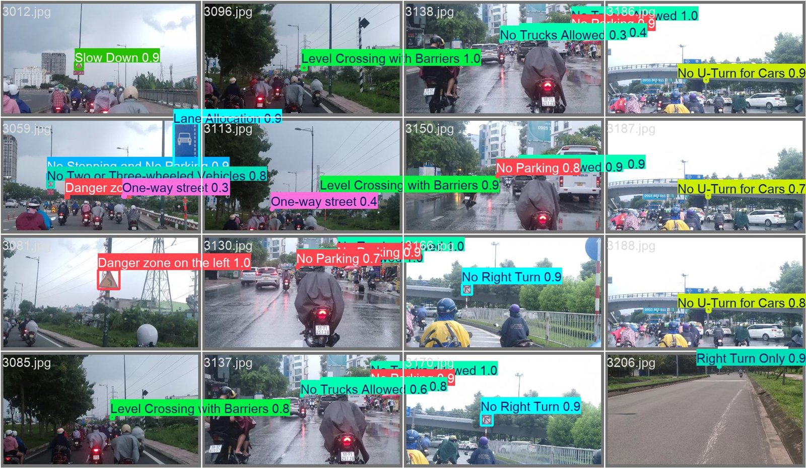
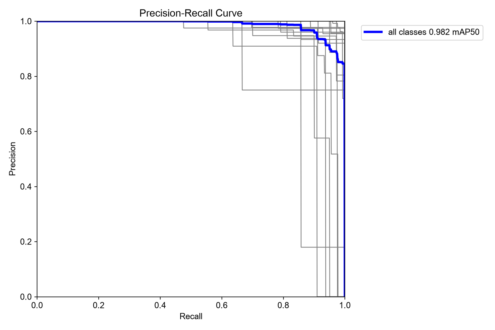
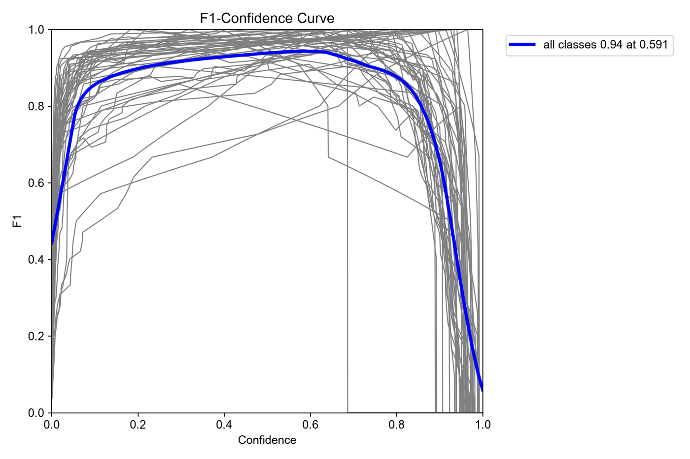
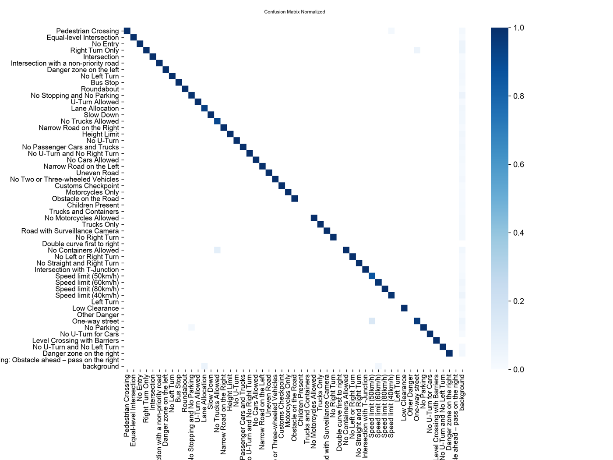

# 🚦 Nhận diện Biển báo Giao thông Việt Nam với YOLO11

[](https://www.python.org/)
[](https://docs.ultralytics.com/models/yolo11/)
[](https://streamlit.io/)

Hệ thống phát hiện và phân loại **52 loại biển báo giao thông Việt Nam** từ ảnh, video và webcam, dựa trên **YOLO11n** (chỉ 2.6M tham số). Project đi trọn một vòng khép kín: chuẩn bị dữ liệu **chống rò rỉ** → huấn luyện → đánh giá chi tiết theo từng lớp → export ONNX/OpenVINO → suy luận video có **tracking** → web demo.

<p align="center">
  
  <br><em>Dự đoán trên ảnh dashcam thuộc tập test (mưa, nhiều xe máy, biển nhỏ ở xa).</em>
</p>
## 🗂️ Dữ liệu

- **Nguồn:** [Vietnam Traffic Signs – Kaggle (`maitam/vietnamese-traffic-signs`)](https://www.kaggle.com/datasets/maitam/vietnamese-traffic-signs), định dạng nhãn YOLO, **52 lớp**.
- **Ảnh dashcam** quay trên đường phố Việt Nam, gồm nhiều khung hình liên tiếp từ cùng một đoạn video.
- **Cách chia:** 80% train / 10% valid / 10% test, `seed = 42`.

| Tập | Ảnh | Biển (instances) | Ghi chú |
| :--- | :---: | :---: | :--- |
| Validation | 324 | 852 | ~2.63 biển/ảnh |
| Test | 320 | 823 | ~2.57 biển/ảnh, **46/52 lớp** có mẫu |

### Chống rò rỉ dữ liệu

Vì dữ liệu gồm các khung hình liên tiếp, chia ảnh ngẫu nhiên sẽ khiến những khung gần như giống hệt nhau rơi vào cả train lẫn test và làm số liệu đẹp giả tạo. Bước `vnsign-prepare` xử lý như sau:

1. Tính **perceptual hash (pHash)** cho từng ảnh.
2. Gom các ảnh có khoảng cách Hamming ≤ 4 vào cùng một nhóm (`data.dedupe_hamming`).
3. Chia **theo nhóm**, nên toàn bộ một nhóm luôn nằm chung một tập.
4. Kiểm tra và loại các dòng nhãn không hợp lệ (sai lớp, toạ độ ngoài [0, 1], thiếu trường), ghi `split_report.json`.

---

## ✨ Điểm nhấn

| | |
| :--- | :--- |
| 🎯 **Độ chính xác** | **mAP@50 = 0.982**, F1 = 0.94 trên tập test độc lập (320 ảnh, 823 biển) |
| ⚡ **Tốc độ** | ~139 FPS trên GPU (RTX 3050 Laptop); 17.5 FPS trên CPU với OpenVINO ở 960×960 |
| 🪶 **Nhẹ** | YOLO11n, 2.6M tham số, file `best.pt` ~5.5 MB |
| 🧹 **Dữ liệu sạch** | Gom ảnh gần giống nhau (khung hình liên tiếp) bằng **pHash** *trước khi* chia train/val/test để tránh rò rỉ dữ liệu |
| 🔁 **Tái lập được** | Toàn bộ tham số nằm ở `configs/default.yaml`, mỗi bước là một lệnh CLI, có unit test |
| 🎬 **Video & Web** | Tracking ByteTrack (mỗi biển chỉ ghi 1 lần) + ứng dụng Streamlit |

---

## 📁 Setup

Yêu cầu: Python 3.10–3.12 (khuyến nghị 3.12), VS Code.

1. Mở thư mục project trong VS Code (`File > Open Folder`) và cài các extension được gợi ý.
2. Chọn Python: `Ctrl+Shift+P` > **Python: Select Interpreter** > chọn bản Python bạn sẽ cài thư viện vào.
   Dùng môi trường ảo (`python -m venv .venv`) là tuỳ chọn; nếu cài thẳng vào Python của máy thì đừng để VS Code chọn nhầm một `.venv` rỗng.
3. **Nếu có GPU NVIDIA**, cài PyTorch bản CUDA trước (lệnh lấy tại https://pytorch.org/get-started/locally/), ví dụ:
   ```powershell
   python -m pip install torch torchvision --index-url https://download.pytorch.org/whl/cu121
   ```
   Nếu bỏ qua, pip sẽ cài bản CPU (vẫn chạy được, chậm hơn nhiều).
4. Cài project:
   ```powershell
   python -m pip install -e ".[dev]"
   ```
5. Kiểm tra:
   ```powershell
   python -m pytest -q
   python -c "import torch, ultralytics; print('GPU:', torch.cuda.is_available(), ultralytics.__version__)"
   ```
   `4 passed` và `GPU: True` là đúng.

Nếu PowerShell chặn kích hoạt môi trường ảo ("running scripts is disabled"): `Set-ExecutionPolicy -Scope CurrentUser RemoteSigned`.

## Cách chạy

Mở **Run and Debug** (`Ctrl+Shift+D`), chọn cấu hình rồi bấm F5, theo thứ tự:

| Bước | Cấu hình | Việc làm |
|---|---|---|
| 1 | EDA dữ liệu | Tự tải dataset từ Kaggle, vẽ biểu đồ vào `reports/eda/` |
| 2 | Prepare data | Kiểm tra nhãn, gom nhóm, chia tập vào `data/processed/` |
| 3b | Train nhanh (2 epoch) | Chạy thử pipeline trước khi train thật |
| 3 | Train | Huấn luyện theo `configs/default.yaml` |
| 4 | Evaluate (test set) | mAP, `reports/per_class_test.csv`, confusion matrix |
| 5 | Export + benchmark | ONNX / OpenVINO + FPS trên CPU |
| 6 | Predict webcam / file | Nhận diện + tracking, xuất `signs_log.csv` |
| 7 | Streamlit demo | Giao diện web |

Hoặc dùng terminal:

```powershell
python -m vnsign.data.eda
python -m vnsign.data.prepare                 # thêm --raw <thư mục> nếu đã có sẵn dữ liệu
python -m vnsign.train.train --name run_moi   # luôn đặt tên riêng cho mỗi lần train
python -m vnsign.eval.evaluate --weights models\best.pt
python -m vnsign.export.export
python -m vnsign.inference.predict --source 0 --show           # webcam, nhấn q để thoát
python -m vnsign.inference.predict --source video.mp4 --show   # video có sẵn
streamlit run app/streamlit_app.py
```

Dữ liệu tự tải từ Kaggle ở lần chạy đầu. Nếu đã có sẵn, đặt thư mục chứa `images/` và `labels/` vào `data/raw/`.

### Webcam

Nếu cửa sổ đen hoặc không mở được, đổi `--source 0` thành `--source 1` (camera ảo như OBS/Zoom có thể chiếm số 0) và tắt các ứng dụng đang dùng camera.
Mô hình được train trên biển nhỏ trong ảnh dashcam, nên với webcam hãy đặt biển (in ra hoặc trên điện thoại) cách camera khoảng 0.5–1 m, hoặc phát video dashcam trên màn hình khác.

## Cấu hình

Mọi tham số nằm trong `configs/default.yaml`. Các giá trị chính:

| Tham số | Giá trị | Ghi chú |
|---|---|---|
| `train.imgsz` | 960 | 640 nhanh hơn ~2 lần nhưng bắt biển nhỏ kém hơn |
| `train.epochs` | 40 | có dừng sớm (`patience: 15`) |
| `train.batch` | 8 | phù hợp GPU 4GB |
| `train.fliplr` | 0.0 | **không** lật ngang vì biển rẽ trái/phải sẽ đảo nghĩa |
| `train.scale` | 0.9 | giúp mô hình quen cả biển ở cự ly gần |
| `infer.conf` | 0.55 | đường F1 đạt đỉnh ở ngưỡng ~0.59 |
| `data.dedupe_hamming` | 4 | ngưỡng gom ảnh giống nhau; `-1` để tắt |

Gợi ý theo phần cứng:

| Máy | Gợi ý |
|---|---|
| Không GPU | `batch: 4`, `epochs` 30; hoặc train trên Kaggle/Colab rồi chép `best.pt` về |
| GPU 4GB | `batch: 8` (ở 960px) |
| GPU 6GB | `batch: 16` |
| GPU ≥ 8GB | `batch: 32`, thử `yolo11s.pt` |
| Mac Apple Silicon | `device: auto` sẽ dùng `mps` |

## Quản lý tệp

Mỗi lần train ghi vào `runs/<name>/`. Nếu trùng `name`, kết quả cũ **bị ghi đè**. Vì vậy:

- Luôn truyền `--name` riêng, ví dụ `python -m vnsign.train.train --name yolo11s_960 --model yolo11s.pt`.
- Sau khi có mô hình tốt, chép ra thư mục an toàn:
  ```powershell
  copy runs\<name>\weights\best.pt models\ten_mo_hinh.pt
  ```
- Chỉ đổi một tham số mỗi lần nếu muốn biết tham số đó đóng góp bao nhiêu.
- `evaluate` dùng `train.imgsz` trong cấu hình; hãy đánh giá cùng kích thước ảnh với lúc train.

## Cấu trúc

```
configs/default.yaml      Toàn bộ tham số (dữ liệu, train, suy luận)
src/vnsign/data/          source (tải), prepare (chia tập), eda
src/vnsign/train/         train.py
src/vnsign/eval/          evaluate.py (AP từng lớp)
src/vnsign/export/        export.py (ONNX/OpenVINO + benchmark)
src/vnsign/inference/     predict.py (ảnh/video/webcam + ByteTrack)
app/streamlit_app.py      Demo web
tests/                    pytest
models/                   Nơi lưu trọng số tốt nhất (bị .gitignore)
notebooks/                Notebook gốc
.vscode/                  settings, launch, tasks
data/ runs/ reports/      Sinh ra khi chạy (bị .gitignore)
```

## Quy trình dữ liệu

1. Kiểm tra nhãn: dòng nhãn sai định dạng hoặc ngoài khoảng hợp lệ bị loại, ảnh không có nhãn được coi là ảnh nền.
2. Tính perceptual hash (pHash) cho từng ảnh, gom các ảnh có khoảng cách Hamming không quá `dedupe_hamming` thành một nhóm.
3. Chia theo nhóm (không chia theo ảnh) thành train/valid/test xấp xỉ 80/10/10, để các khung hình gần giống nhau không rơi vào hai tập khác nhau.
4. Ghi `data/processed/` kèm `dataset.yaml` và `split_report.json`. Ảnh không bị resize hay augment offline.

Với dữ liệu hiện tại: 3.216 ảnh thành 2.346 nhóm (nhóm lớn nhất 22 ảnh); 2.572 / 324 / 320 ảnh cho train / valid / test; 2 lớp vắng trong valid và 6 lớp vắng trong test vì quá hiếm.

---

## 🏋️ Huấn luyện

| Tham số | Giá trị |
| :--- | :--- |
| Mô hình | `yolo11n.pt` (pretrained COCO) |
| Kích thước ảnh | 960 × 960 |
| Epochs / Patience | 40 / 15 |
| Batch | 8 |
| Optimizer LR | cosine (`cos_lr: true`) |
| Phần cứng | NVIDIA RTX 3050 Laptop (4 GB VRAM), ~45.5 phút |

**Augmentation (do Ultralytics xử lý khi train):** `mosaic = 1.0` (tắt ở 5 epoch cuối), `scale = 0.9`, `translate = 0.1`, `degrees = 5`, HSV (`0.015 / 0.7 / 0.4`).

> ⚠️ **`fliplr = 0`:** lật ngang bị **tắt** có chủ đích vì sẽ đảo nghĩa các biển *cấm rẽ trái / rẽ phải*, *đường hẹp bên trái / phải*, *nguy hiểm bên trái / phải*.

Chọn ảnh 960 thay vì 640 để cải thiện khả năng bắt **biển nhỏ ở xa** – tình huống phổ biến trong ảnh dashcam.

---

## 📈 Kết quả

### Tổng quát

| Tập | Precision | Recall | mAP@50 | mAP@50-95 | GPU latency | GPU FPS |
| :--- | :---: | :---: | :---: | :---: | :---: | :---: |
| Validation | 0.936 | 0.899 | 0.975 | 0.748 | 4.1 ms | ~244 |
| **Test** | **0.941** | **0.954** | **0.982** | **0.757** | 7.2 ms | ~139 |

- Đỉnh **F1 = 0.94 tại `conf = 0.591`** → khuyến nghị dùng ngưỡng **0.50 – 0.60** khi suy luận.
- Khoảng cách giữa mAP@50 (0.982) và mAP@50-95 (0.757) cho thấy mô hình **phát hiện tốt nhưng khung chưa thật khít** ở các ngưỡng IoU cao, hợp lý với biển rất nhỏ trong ảnh.

<table>
  <tr>
    <td align="center"><b>Precision–Recall</b></td>
    <td align="center"><b>F1 – Confidence</b></td>
  </tr>
  <tr>
    <td></td>
    <td></td>
  </tr>
</table>

<p align="center">
  
  <br><em>Confusion matrix chuẩn hoá trên tập test: đường chéo rất đậm, lỗi chủ yếu là bỏ sót (<code>background</code>) chứ không phải nhầm giữa các lớp.</em>
</p>

### Theo từng lớp (46 lớp có mẫu trong tập test)

Chi tiết đầy đủ nằm trong `reports/per_class_test.csv` (sinh bởi `vnsign-eval`).

| Chỉ số | Trung bình | Trung vị | Thấp nhất | Số lớp ≥ 0.95 |
| :--- | :---: | :---: | :--- | :---: |
| Precision | 0.941 | 0.955 | 0.628 (*Low Clearance*, 4 mẫu) | 26 / 46 |
| Recall | 0.954 | 1.000 | 0.761 (*Speed limit 50 km/h*) | 31 / 46 |
| AP@50 | 0.982 | 0.995 | 0.880 (*Speed limit 50 km/h*, *No Trucks Allowed*) | 41 / 46 |
| AP@50-95 | 0.757 | 0.760 | 0.497 (*Equal-level Intersection*, 2 mẫu) | — |

**Phân nhóm theo AP@50:** 32 lớp ≥ 0.99 · 9 lớp từ 0.95 đến 0.99 · **5 lớp < 0.95**.

#### Các lớp yếu nhất

| Biển báo | Mẫu test | Precision | Recall | AP@50 | AP@50-95 | Quan sát |
| :--- | :---: | :---: | :---: | :---: | :---: | :--- |
| Speed limit (50 km/h) | 7 | 1.000 | 0.761 | 0.880 | 0.600 | Bỏ sót biển nhỏ; đôi lúc nhầm với *One-way street* |
| No Trucks Allowed | 11 | 0.907 | 0.909 | 0.880 | 0.650 | Nhầm lẫn với *No Containers Allowed* |
| No U-Turn and No Right Turn | 3 | 0.703 | 0.814 | 0.913 | 0.814 | Rất ít mẫu |
| One-way street | 20 | 0.941 | 0.799 | 0.913 | 0.708 | ~20% bị bỏ sót (nhận là nền) |
| Lane Allocation | 16 | 0.848 | 0.938 | 0.928 | 0.823 | Có dương tính giả từ nền |

### Benchmark triển khai (CPU)

Đo trên 50 ảnh test, đầu vào `1×3×960×960`, CPU **AMD Ryzen 5 7535HS**:

| Định dạng | Dung lượng | FPS | Latency | So với PyTorch |
| :--- | :---: | :---: | :---: | :---: |
| **OpenVINO** | 10.5 MB | **17.46** | **57.3 ms** | +10% |
| PyTorch (`.pt`) | **5.5 MB** | 15.85 | 63.1 ms | baseline |
| ONNX | 10.4 MB | 12.61 | 79.3 ms | −20% |

> Benchmark chạy trên tập nhỏ (50 ảnh), nên chênh lệch ~10% giữa OpenVINO và PyTorch chỉ mang tính tham khảo. Kết quả còn phụ thuộc phần cứng và phiên bản thư viện.

---

## ⚠️ Hạn chế

Để đánh giá kết quả một cách trung thực:

- **Tập test nhỏ và phân bố lệch.** 15/46 lớp chỉ có ≤ 5 mẫu trong test, nên AP@50 của các lớp đó (nhiều lớp đạt 0.995) **không có nhiều ý nghĩa thống kê**. 6/52 lớp không xuất hiện trong test nên chưa được kiểm chứng.
- **Dữ liệu cùng miền.** Ảnh chủ yếu quay bằng dashcam trong cùng điều kiện (đô thị, trời mưa/âm u). Kết quả phản ánh khả năng trong miền này; khả năng tổng quát hoá sang ban đêm, nắng gắt, camera khác, tỉnh thành khác **chưa được kiểm chứng**.
- **Chưa có khoảng tin cậy.** Mỗi cấu hình chỉ huấn luyện một lần (`seed = 42`), chưa chạy nhiều seed nên chênh lệch nhỏ giữa val và test nằm trong mức nhiễu.
- **Biển nhỏ ở xa** vẫn là nguồn lỗi chính (bỏ sót), thể hiện qua recall thấp ở các biển tốc độ và *One-way street*.

## 🛣️ Hướng phát triển

- [ ] Thu thêm dữ liệu cho các lớp hiếm và các lớp chưa có trong test; chia tập theo **video/tuyến đường** để đánh giá tổng quát hoá chặt chẽ hơn.
- [ ] So sánh `yolo11s/m` để cải thiện mAP@50-95; thử tăng độ phân giải hoặc tiling cho biển nhỏ.
- [ ] Lượng tử hoá INT8 và đo độ giảm chính xác.
- [ ] Triển khai trên thiết bị biên (Jetson / Raspberry Pi).
- [ ] CI (GitHub Actions) chạy `ruff` + `pytest`.

---

## Ghi nhận

- Dữ liệu: [maitam/vietnamese-traffic-signs](https://www.kaggle.com/datasets/maitam/vietnamese-traffic-signs) trên Kaggle. Vui lòng xem trang dataset để biết điều khoản sử dụng và trích dẫn tác giả.
- Mô hình và công cụ: [Ultralytics YOLO11](https://github.com/ultralytics/ultralytics), [ByteTrack](https://github.com/ifzhang/ByteTrack), [OpenVINO](https://docs.openvino.ai/), [Streamlit](https://streamlit.io/).

